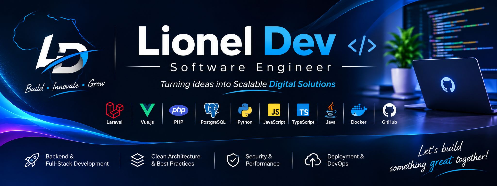

<!-- PROFILE BANNER -->

  

<h1 align="center">Hi, I'm Lionel Dev 👋</h1>

<h3 align="center">Software Engineer | Backend & Full-Stack Developer</h3>

  Building scalable applications, designing robust architectures and turning ideas into digital solutions.

  
  
  

---

## 👨‍💻 About Me

I'm a **Software Engineer** passionate about designing, developing and deploying modern software solutions.

My work focuses on building reliable backend systems, intuitive user interfaces and complete applications that solve real-world problems.

I enjoy exploring different programming languages, frameworks and technologies, with a particular interest in software architecture, API development, database engineering and application security.

**What defines my approach:**

- Writing clean, reusable and maintainable code.
- Designing scalable application architectures.
- Building secure APIs and business-oriented applications.
- Developing responsive and intuitive user interfaces.
- Working across the entire software development lifecycle.
- Continuously learning and exploring new technologies.

- 🔭 Currently building web applications and backend solutions.
- 🌱 Exploring Docker, Keycloak, OAuth 2.0, OpenID Connect and DevOps.
- 💡 Interested in software engineering, system design and emerging technologies.
- 🎯 Focused on continuous improvement and meaningful projects.

---

## 🛠️ Technologies & Tools

I work with different technologies depending on the requirements and objectives of each project.

### Programming Languages

  
  
  
  
  
  
  

### Backend Development

  
  
  
  
  

### Frontend Development

  
  
  
  
  
  

### Mobile Development

  
  

### Databases & Caching

  
  
  
  

### DevOps, Tools & Environment

  
  
  
  
  
  
  
  

---

## 🧠 Areas of Expertise

| Area | Focus |
|---|---|
| Backend Engineering | APIs, business logic, services and application architecture |
| Full-Stack Development | Complete web applications and system integration |
| Database Engineering | Data modeling, relational databases and optimization |
| Application Security | Authentication, authorization, RBAC and access control |
| Software Architecture | Clean code, modularity and maintainability |
| DevOps & Deployment | Linux, VPS, Nginx and production environments |
| Mobile Development | Cross-platform applications with Flutter |

---

## Professional & Personal Work

I enjoy working on software solutions that address practical business and organizational challenges.

Some areas I have worked on include:

- Enterprise and organizational management platforms.
- Multi-level administration and role-based access systems.
- API-driven applications and backend services.
- Digital workflow and document management solutions.
- Data management and operational tracking systems.
- Web application deployment and server infrastructure.

**Note:** Some projects are developed for organizations or private clients and remain in private repositories. Their source code is therefore not publicly available.

My public repositories showcase independent experiments, technical implementations, reusable solutions and learning projects.

---

## 📚 Currently Exploring

- Keycloak and centralized identity management.
- OAuth 2.0 and OpenID Connect.
- Advanced software architecture patterns.

---

## 🌐 Let's Connect

I'm always open to exchanging ideas, discussing software engineering, exploring new technologies and collaborating on interesting projects.

  
  
  

  <b>Build. Innovate. Grow.</b> 
  <i>Turning ideas into scalable digital solutions.</i>

